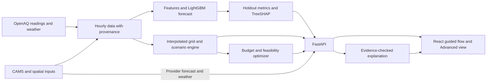

<div align="center">
  
  <h1>AirTwin</h1>
  <p>See the air. Test what could change it.</p>
  <p>An environmental digital twin for Pune and Pimpri-Chinchwad.</p>
  <p>
    <a href="https://github.com/RajvardhanPatil07/AirTwin/actions/workflows/ci.yml"></a>
    &nbsp; <a href="#run-it-locally">Run locally</a> · <a href="#what-you-can-explore">Explore the guide</a> · <a href="#how-to-read-the-results">Read the evidence</a> · <a href="#future-directions">Future directions</a>
  </p>
</div>


*Verified interface capture from 10 October 2026. Values belong to that snapshot; check timestamps and source labels in the running app.*

AirTwin helps you explore air quality in Pune and Pimpri-Chinchwad, understand a forecast, and compare assumed pollution controls. The default interface walks through eight steps, with backend results and an evidence-based assistant. **Advanced view** opens the full map, replay, feed, and sensor-resilience dashboard.

## What you can explore

| Step | What you can do | Where the result comes from |
| --- | --- | --- |
| 1. Place | Search for a supported area and choose a reference point | Backend locations and geographic coordinates |
| 2. Air today | See PM2.5, weather, nearby points, and the concentration grid | Timestamped provider data with observed or modeled labels |
| 3. Forecast | Compare 24-, 48-, and 72-hour PM2.5 outlooks | Backend forecast, model identity, input cutoff, and disclosed fallbacks |
| 4. Understand | Explore source proxies and ask AirTwin questions | Backend attribution and Gemini answers with evidence citations |
| 5. Try actions | Adjust traffic, industry, and dust reductions; calculate a before/after comparison | Backend scenario engine with assumed intervention responses |
| 6. Plan | Set an INR budget, target reduction, and unavailable actions | Forecast-based package optimizer with feasibility checks |
| 7. Evidence | Compare historical predictions with measurements and persistence | Chronological backtest, metrics, and validation limitations |
| 8. Review | Inspect the comparison and download a JSON review | Selected backend location, scenario results, plan, and provenance |

The guide supports light and dark themes and adapts to mobile screens. It uses the installed Vengeance UI navigation and animated buttons, alongside Leaflet maps and Recharts charts. [Frontend design and verification](frontend/design-qa.md) · [Component attribution](frontend/src/components/ui/ATTRIBUTION.md)

Advanced view adds map layers, forecast playback, an observed AQI feed, historical replay, and planning under simulated sensor loss. AQI and PM2.5 use different units and are shown separately. Intervention comparisons are simulations, not measured policy effects or health outcomes.

The current Pune–PCMC view refreshes CAMS/Open-Meteo air-quality and weather forecasts at 25 named area reference points while the backend runs, plus OpenAQ PM2.5 station readings when they pass a 24-hour freshness check. These reference points are modeled samples, not neighborhood monitors. When there are no fresh observations, the interface says so and identifies the displayed values as modeled. Historical replay uses the separate LightGBM model blended with persistence. Historical model backtests do not validate current provider forecasts. [Architecture](docs/architecture.md) · [API](docs/api.md) · [Data sources](docs/data_sources.md)

## Run it locally

You need Python 3.11, Node.js 22, and npm. On macOS, LightGBM may also need the OpenMP runtime (`libomp`).

```sh
git clone --branch dev/raj https://github.com/RajvardhanPatil07/AirTwin.git
cd AirTwin
python3.11 -m venv .venv311
source .venv311/bin/activate
python -m pip install -r backend/requirements.txt
npm --prefix frontend ci
cp .env.example .env
# Add optional provider keys to .env before starting.
python scripts/dev.py
```

Open [AirTwin](http://127.0.0.1:5188/). [API documentation](http://127.0.0.1:8000/docs) and [API health](http://127.0.0.1:8000/api/health) are available on the backend. `scripts/dev.py` starts both services; set `AIRTWIN_FRONTEND_PORT` to use a different frontend port. First startup can take several minutes because the backend trains a model if no matching artifact exists. With no downloaded dataset, it trains on the committed **synthetic sample**. That exercises the workflow but does not reproduce the observed-data results below.

To run the full synthetic pipeline, use `bash scripts/run_all.sh --offline`. The running backend fetches current Pune–PCMC provider context every 15 minutes when `LIVE_REFRESH_ENABLED=1`. An OpenAQ key enables observed-station discovery; CAMS/Open-Meteo model context does not require that key. Historical PCMC model training remains a separate operation: set provider credentials in the root `.env` and run `bash scripts/run_all.sh --live` when you want to rebuild it. The root `.env` is ignored by Git. [Setup and failure cases](docs/troubleshooting.md) · [Pipeline](docs/data_pipeline.md)

For persistent provider history in a hosted backend, provision PostgreSQL and set `DATABASE_URL` on the backend service. Each successful Pune–PCMC refresh is stored as a timestamped JSONB snapshot, with 30-day retention; the latest database snapshot is used after a restart. Without `DATABASE_URL`, the existing local JSON cache continues to work. `/api/health` reports database connectivity and stored snapshot timestamps. Provider refresh cadence is controlled by `LIVE_REFRESH_SECONDS` (default 15 minutes). The guide checks for updated data every 15 minutes and offers **Refresh connection**; Advanced view checks every 30 seconds. Source freshness still depends on the provider.

The frontend uses the local API through Vite's `/backend` proxy. If the API is unavailable at initial load, it switches to a labeled, illustrative frontend demo. For a hosted frontend, set `VITE_API_BASE_URL` to a public backend URL and allow the frontend origin in `CORS_ORIGINS`. An explicitly empty API URL selects demo mode. [Deployment details](frontend/README.md)

## Ask AirTwin and configuration

Set these variables in the root `.env` or backend service environment:

| Variable | Purpose |
| --- | --- |
| `GEMINI_API_KEY` | Enables Gemini answers in Ask AirTwin |
| `GEMINI_MODEL` | Gemini model ID; `.env.example` currently sets `gemini-3.5-flash-lite` |
| `OPENAQ_API_KEY` | Enables observed PM2.5 station discovery and historical data access |
| `DATABASE_URL` | Optional PostgreSQL persistence for provider snapshots |
| `LIVE_REFRESH_ENABLED` / `LIVE_REFRESH_SECONDS` | Provider refresh switch and interval; example defaults are `1` / `900` |
| `CORS_ORIGINS` | Allowed frontend origins for a hosted backend |

Ask AirTwin receives the selected location, forecast horizon, calculated action cuts, and recent conversation. The backend builds context from its computed outputs, calls Gemini, and checks returned claims against evidence IDs, numeric values, and provenance. The interface identifies the model and cites the evidence.

If the key is absent or Gemini fails, the backend returns a labeled **evidence summary**. That summary is not a Gemini answer. Evidence checks do not prove semantic or causal correctness. Gemini was verified through the API and guided chat during the 10 October integration. [Verified response capture](frontend/docs/guided-evidence/connected-chat.png)

Keep provider keys and database credentials on the backend. For a hosted frontend, `VITE_API_BASE_URL` contains only the public backend URL. An empty value explicitly selects the illustrative frontend demo. For local development, leave it unset to use the same-origin `/backend` proxy. [Frontend setup](frontend/README.md)

## How to read the results

AirTwin keeps input provenance visible:

| Label | Meaning |
| --- | --- |
| **OBSERVED** | Measured provider readings, such as station PM2.5 |
| **MODELED** | Forecasts, CAMS and weather context, interpolated map cells, or scenario estimates |
| **SYNTHETIC** | Constructed sample or demo inputs |

A measured station value does not turn nearby interpolated cells or intervention estimates into observations. Provider data can arrive late, so a working dashboard is not proof of a current reading. Population estimates for PCMC come from WorldPop 2020 and selected OpenStreetMap geometry; zone activity and intervention responses remain proxies. [Spatial inputs and licenses](docs/spatial_sources.md) · [Assumptions](docs/assumptions.md)

### Recorded model evidence

<!-- computed-model-summary:start -->
Observed-target winter holdout (Nov 2025 – Jan 2026), pooled across stations:

| Horizon | AirTwin MAE (µg/m³) | Persistence MAE | Improvement | p10–p90 coverage |
| --- | --- | --- | --- | --- |
| 1 h | 9.76 | 10.52 | +7.2% | 90.8% |
| 3 h | 19.00 | 22.53 | +15.7% | 86.4% |
| 6 h | 24.56 | 32.53 | +24.5% | 81.1% |
| 12 h | 25.88 | 40.23 | +35.7% | 80.2% |
| 24 h | 20.01 | 21.81 | +8.2% | 90.3% |
| 48 h | 22.59 | 26.06 | +13.3% | 90.1% |
| 72 h | 25.09 | 29.19 | +14.0% | 89.2% |

AirTwin beats persistence at every horizon on this holdout. At 24 h the pooled
MAE is 20.01 µg/m³ (R² 0.56); the training-only seasonal mean scores
52.51. Raw CAMS at the city centroid scores ~48 µg/m³ MAE, so it is
used as a covariate, not as the forecast. Values describe this recorded run, not guarantees.
<!-- computed-model-summary:end -->

These figures belong to one retrospective dataset and its generated [model card](docs/model_card.md). Rebuilding with synthetic data will change the metrics. Some stations lose to persistence even when the pooled result improves. Provider publication delays and fully operational 48/72-hour inputs still need independent evaluation. [Validation protocol](docs/validation_protocol.md) · [Seasonal stress test](docs/evidence/seasonal_validation.md)

During the 10 October integration check, the Bhosari monitor-specific 24-hour benchmark had MAE **16.89 µg/m³**, compared with persistence MAE **11.10 µg/m³**: it underperformed persistence by **52.2%** on that holdout. The Evidence screen displays this warning. This station benchmark is separate from the pooled historical results above and the current CAMS forecast. [Observed benchmark capture](frontend/docs/guided-evidence/connected-evidence.png)

Intervention benefit is expressed in **person·µg/m³**, a population-weighted concentration reduction proxy. It is an assumption-based scenario estimate, not causal evidence that an intervention will reduce pollution. Scenario bounds come from assumption sensitivity; forecast bands come from model residuals. Neither is a measured health outcome. The UI shows the absolute scenario delta at extra precision so small modeled changes remain visible. [Methodology](docs/methodology.md) · [Intervention sensitivity](docs/evidence/intervention_sensitivity.md)

## How it works

| Layer | Technology |
| --- | --- |
| Frontend | React, TypeScript, Vite, Tailwind CSS v4, Base UI/shadcn components, Vengeance UI, Framer Motion |
| Maps and charts | Leaflet / React Leaflet, OpenStreetMap tiles, Recharts |
| Backend | FastAPI, Python 3.11, LightGBM, scikit-learn, TreeSHAP |
| Assistant | Gemini with backend evidence and claim checks |
| Storage | Local provider cache; optional PostgreSQL snapshots |



The forecast model and the scenario engine answer different questions. TreeSHAP describes predictive features; traffic, industry, and dust shares come from configurable spatial assumptions. [Model design](docs/model_card.md) · [Scenario assumptions](docs/assumptions.md)

## Live feed and final-round implementation

The dashboard now includes a timestamped observed AQI feed, guarded live concentration forecasts, a budget planner, sensor-loss replay and withheld-monitor historical evidence. Read the [workflow and limitations](docs/final_round_workflow.md). Fresh AQI is separate from measured PM2.5: the available OpenAQ concentration feed was delayed during verification.

## Future directions

The next step is to connect four parts of a city decision: **predict, act, measure, and learn**. The ideas below are proposals, not features in this build. Their value would come from testing the whole chain in Pune and PCMC, with the failures visible alongside the successes. [Research notes and source links](docs/research/airtwin-future-directions-2026-09-28.md)

### A policy trial that grades its own prediction

Before a road-dust, traffic, or industrial action begins, a city team could record the planned action, area, dates, cost, and AirTwin's expected change. The system would freeze that prediction, then compare later observations with a suitable untreated area while accounting for weather and trends. The first pilot would need a real action log and enough monitoring on both sides. A simple before-and-after drop would never count as proof of impact; the published result could also say the original scenario was wrong. [EPA's intervention accountability framework](https://assessments.epa.gov/risk/document/%26deid%3D364752)

### A sensor mission planner

Instead of adding sensors wherever installation is easiest, AirTwin could identify locations where a new measurement would most improve a forecast or change an intervention choice. Each suggestion would show the question it answers, expected information gain, and practical siting constraints. A first trial could compare one recommended site with a reference monitor and check whether uncertainty actually fell. Low-cost sensors would require collocation and quality checks before their readings influence decisions. [EPA sensor guidance](https://www.epa.gov/air-sensor-toolbox/how-use-air-sensors-air-sensor-guidebook)

### Cleaner journeys with honest uncertainty

A future route view could compare departure times and walking, cycling, or transit options by estimated exposure, travel time, safe crossings, and accessibility. It should mark which parts of a route have measurements and which rely on a model. The current 12×12 grid is too coarse for street-level advice; this feature would first need a finer, independently tested pollution surface and privacy-conscious route handling. [WHO guidance on personal exposure choices](https://www.who.int/publications/i/item/WHO-EURO-2024-9115-48887-72806)

### An intervention portfolio with a fairness guardrail

City planners could enter a budget and compare packages of dust, traffic, and industrial controls across plausible weather and response assumptions. Results would show estimated gains by neighborhood, cost, and where a citywide average hides a poor outcome for a highly exposed area. An early version could use transparent sensitivity ranges, then replace proxy response factors as local evidence arrives. It would not label modeled concentration reductions as measured health benefits. [WHO on unequal air-pollution exposure](https://www.who.int/teams/environment-climate-change-and-health/air-quality-energy-and-health/sectoral-interventions/ambient-air-pollution/health-equity)

### Independent signals and a forecast flight recorder

For a major intervention, ground readings and wind could be checked against a separate [Sentinel-5P NO₂ product](https://documentation.dataspace.copernicus.eu/APIs/SentinelHub/Data/S5PL2.html). Satellite NO₂ is a broad, different measurement; it cannot be converted into street-level PM2.5 or treated as proof of a local source. Alongside that check, each AirTwin forecast could save its input timestamps, model version, missing sensors, fallbacks, assumptions, and eventual error. A first milestone is a replayable answer to: *what did the system know when it made this recommendation?* If inputs are too stale, it should say so and hold back a detailed recommendation.

These directions depend on new data partnerships, validation, and city participation. The [current roadmap](docs/roadmap.md) tracks nearer-term model and operational work; the [research note](docs/research/airtwin-future-directions-2026-09-28.md) records the evidence and limits behind these longer-term proposals.

## Check the project

With the Python virtual environment activated:

```sh
PYTHONPATH=backend python -m pytest backend/tests -q
npm --prefix frontend test
npm --prefix frontend run lint
npm --prefix frontend run build
npm --prefix frontend run test:sites
python scripts/check_repository.py
python scripts/check_documentation.py
```

The guided integration passed 15 frontend tests and 25 targeted backend API/state/planning tests, plus lint, production build, and four Sites packaging checks. These are integration checks, not a model-accuracy claim. CI also runs the offline pipeline without provider keys. [Testing guide](docs/testing.md) · [Recorded verification](docs/verification.md)

## Find your way around

| Path | Purpose |
| --- | --- |
| [`backend/app`](backend/app) | FastAPI routes, forecasting, explanations, and scenarios |
| [`backend/scripts`](backend/scripts) | Fetch, build, train, and validation commands |
| [`frontend/src`](frontend/src) | Guided flow, Advanced view, and labeled demo engine |
| [`config/assumptions.yaml`](config/assumptions.yaml) | Scenario assumptions |
| [`data/sample`](data/sample) | Offline sample and sourced spatial inputs |
| [`docs`](docs) | Evidence, architecture, data provenance, and demo notes |

Contributions are welcome through [CONTRIBUTING.md](CONTRIBUTING.md); report security issues through [SECURITY.md](SECURITY.md). Data and map attribution are documented in [data sources](docs/data_sources.md). No project-wide software license has been selected.


### Automatic LightGBM retraining (observed targets only)

The backend runs a **separate unattended retraining check** while it is up
(default: first check 15 minutes after startup, then every 24 hours). Provider
ingestion continues on its own 15-minute cycle. Retraining is **not** triggered
by every snapshot: it requires at least 48 newly stored *observed station-hours*
since the previous promotion (or latest historical observed target), at least
720 total observed training rows spanning 14 distinct days, and at least seven
days since the last successful promotion. Missing/stale OpenAQ data means the
check safely skips. Changing these thresholds is possible through the
environment variables below.

The candidate combines the historical **observed** training set (when
available) with retained OpenAQ station-hours in PostgreSQL/Supabase or local
SQLite. It never treats CAMS-modeled or synthetic PM2.5 as observed targets.
Missing historical weather is left missing, not imputed using future conditions.
It uses a recent chronological 20% holdout with purged training boundaries;
promotion requires an adequate holdout and 24-hour MAE strictly better than the
persistence baseline (ties are rejected). Failed training/validation leaves the previously served
model unchanged. No fixed improvement in live forecast accuracy is claimed.

Approved candidates are atomically installed as
`backend/models/forecast_live.joblib`, separate from the historical
`forecast.joblib`. The live observed-station forecast dispatcher prefers this
artifact and falls back to the previous observed-only historical artifact if
needed. Historical replay stays unchanged. **On `dev/raj`, the existing
station-specific selector still has first priority for eligible 24-hour
forecasts**; the persisted live model serves eligible requests that reach the
dispatcher, including other horizons. The new artifact is local to the backend
instance; for deployment persistence across restarts, attach a persistent disk
for `backend/models` or implement shared artifact storage. Database history
continues to persist separately when `DATABASE_URL` is set.

Check `GET /api/health` for the new `retraining` object; it reports
`pending`, `skipped`, `rejected`, `promoted`, or `error`, with a reason.

| Environment variable | Default | Purpose |
| --- | --- | --- |
| `RETRAIN_ENABLED` | `1` | Start the unattended trainer thread |
| `RETRAIN_INITIAL_DELAY_SECONDS` | `900` | Allow provider history ingestion before the first check |
| `RETRAIN_CHECK_HOURS` | `24` | Interval between checks |
| `RETRAIN_MIN_GAP_HOURS` | `168` | Minimum interval between successful model promotions |
| `RETRAIN_MIN_NEW_ROWS` | `48` | Minimum newly collected observed station-hours |
| `RETRAIN_MIN_OBSERVED_ROWS` | `720` | Minimum total observed target rows |
| `RETRAIN_MIN_TEST_ROWS` | `48` | Minimum recent 24h holdout targets |

These safeguards prevent blind retraining on every frontend refresh. A
promotion checks the holdout against persistence, **not** live A/B performance
or causal effects. Multiple hosted instances must share database storage for
history; PostgreSQL advisory locking prevents simultaneous retraining, but
model files remain instance-local without shared artifact storage.
