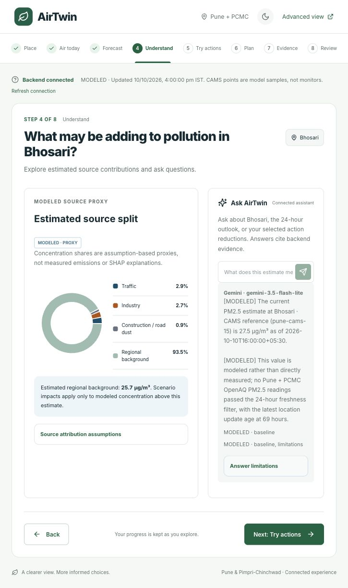

# AirTwin frontend

The React/Vite/TypeScript frontend opens the eight-step AirTwin guide for Pune and Pimpri-Chinchwad. **Advanced view** provides the full dashboard with map layers, forecast playback, observed AQI, historical replay, and sensor-resilience planning.



*Verified capture from 10 October 2026; values and model availability depend on the running backend.*

## Run locally

Install the Python and frontend dependencies using the [project setup](../README.md#run-it-locally), then run this from the repository root:

```sh
python scripts/dev.py
```

Open [AirTwin](http://127.0.0.1:5188/). FastAPI runs on port 8000; Vite forwards `/backend` requests to it. The launcher starts both services and reuses an already healthy backend. It does not rerun the data pipeline, although backend startup can train a missing model artifact.

To start only the frontend from this directory:

```sh
npm ci
npm run dev
```

Vite prints its frontend URL. Keep FastAPI running separately for backend results. The proxy also works with `npm run preview`. `AIRTWIN_BACKEND_URL` can change the proxy target when starting Vite.

## Guided flow

1. **Place:** choose a backend-supported area reference point.
2. **Air today:** inspect PM2.5, modeled weather, nearby reference points, and map cells.
3. **Forecast:** select a 24-, 48-, or 72-hour horizon and inspect provider/model information.
4. **Understand:** inspect assumed source contributions and ask AirTwin about computed evidence.
5. **Try actions:** adjust traffic, industry, and dust cuts; calculate backend scenario results.
6. **Plan:** set an INR budget and target; exclude unavailable actions and check feasibility.
7. **Evidence:** inspect historical measured targets, model errors, and persistence comparisons.
8. **Review:** compare the current estimate and calculated actions; export backend results as JSON.

The guide uses adapted Vengeance UI Spotlight Navbar and Animated Button components, Leaflet geography, and Recharts visualizations. It supports mobile layouts, dark theme, and reduced motion. Budgets and selected cuts persist during guided navigation; page reloads and switching between guided and Advanced view reset guide state.

## Backend and assistant configuration

Provider credentials belong in the **root** `.env`, which FastAPI loads. Set `GEMINI_API_KEY` to enable Gemini and use `GEMINI_MODEL` to select its model; the root example currently sets `gemini-3.5-flash-lite`. Ask AirTwin sends the selected location, horizon, calculated cuts, and recent conversation to `/api/explain`. Answers display the actual model and backend evidence citations. A provider failure or missing key produces a labeled evidence summary.

For a hosted frontend, copy this directory's `.env.example` to `.env`, set `VITE_API_BASE_URL` to the public backend URL, and allow the frontend origin in backend `CORS_ORIGINS`. Restart Vite after changing frontend environment variables. Provider keys and database passwords must never use `VITE_` variables.

For local development, leave `VITE_API_BASE_URL` unset to use `/backend`. Set `VITE_API_BASE_URL=` explicitly for the illustrative frontend-only demo.

Initial API failure switches the guide to an **Offline example** with a connection warning. **Refresh connection** retries the backend. Analysis failures display errors and Retry; connected analyses do not substitute mock outputs. Demo chat explains its availability without claiming an AI answer.

## Reading the results

- Observed, modeled, and synthetic labels identify provenance. Check the displayed timestamps.
- Named CAMS points are model samples, not monitors at those locations. Current provider forecasts and historical LightGBM evaluation are separate.
- Source shares and intervention responses are assumption-based proxies. Simulated reductions are not measured improvements or health benefits.
- Scenario statistics and before/after maps use the same backend result. Population provenance follows the response; offline examples use synthetic inputs.
- Station backtests can underperform persistence. Missing history, uncertainty bands, and optional metrics remain unavailable.
- Planning costs and response factors are synthetic assumptions. Targets can be infeasible.
- OpenStreetMap tiles require network access. Fonts are bundled. Retain map/provider credits and [Vengeance component attribution](src/components/ui/ATTRIBUTION.md).

## Checks and implementation

```sh
npm run lint
npm test
npm run build
npm run test:sites
```

The build performs TypeScript checks, bundles the app, and prepares the Sites artifacts. The frontend currently has 15 unit tests and four Sites packaging checks. Mock-engine tests verify demo behavior, not backend model accuracy.

| Path | Purpose |
| --- | --- |
| `src/pages/GuidedExperience.tsx` | Guided navigation, area selection, connection state, and review export |
| `src/components/GuidedBackendPanels.tsx` | Connected analyses, planning, and inline Ask AirTwin |
| `src/components/GuidedAirMap.tsx` | Guide map and backend concentration cells |
| `src/pages/Dashboard.tsx` | Advanced dashboard |
| `src/lib/api.ts` / `src/lib/operations.ts` | Shared backend requests and planning contracts |
| `src/guided.css` | Scoped guide theme and responsive styles |

See [API documentation](../docs/api.md), [design](DESIGN.md), [verification](design-qa.md), and [screenshots](docs/guided-evidence/). [Component licensing](src/components/ui/ATTRIBUTION.md) applies to the adapted UI components; no project-wide software license has been selected.
